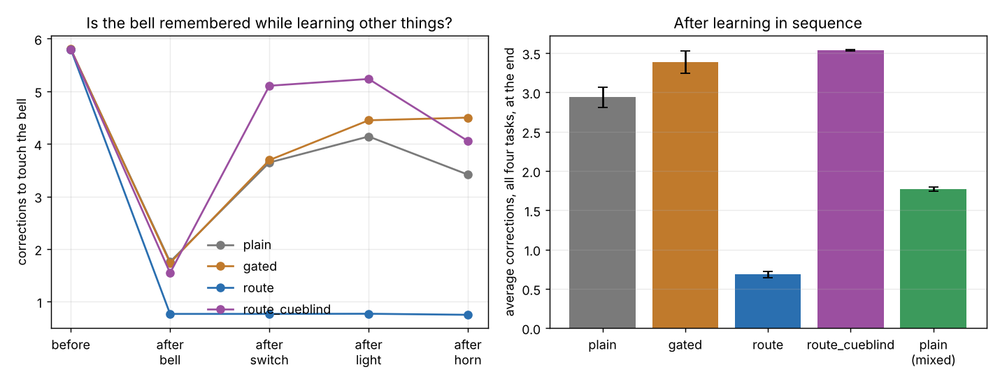
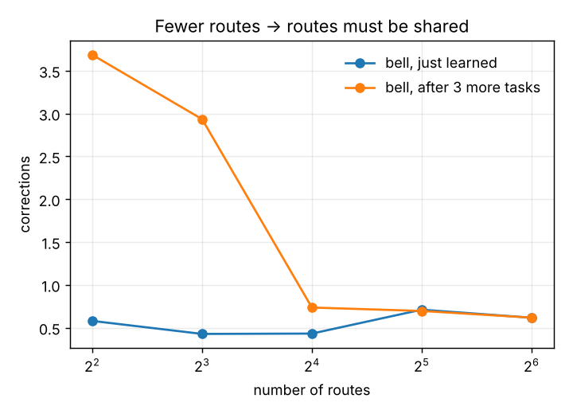
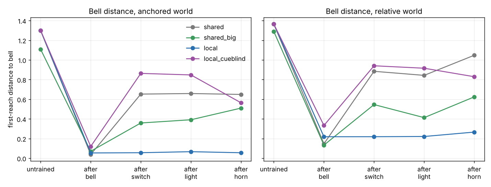

# SimplyPutClaude

**Can one arm learn a new blind reach without forgetting the old one?**

## The story it comes from

A bike bell sits on the seat post because there was no room on the handlebars.
You can't see it. At first you fumble for it, badly enough that you stop using
it for a while. After a summer of riding, your hand finds it with almost no
thought, one-handed, while the bike moves.

Two things happened:

1. **The fumble became a reflex.** Each search ended in contact, and the reach
   that worked was kept. Eventually there was nothing left to correct.
2. **Nothing else broke.** The same arm, the same brain, still reaches for the
   brake, the light, your pocket. A new skill was written into a shared body
   without erasing the old ones.

Point 1 is easy to model (a lookup table does it; see the sibling repo
[SimplyPut](https://github.com/anttiluode/SimplyPut)). Point 2 is the hard
one. In a shared learning system, a new skill usually overwrites old ones. In
machine learning this is **catastrophic forgetting**, and it is still an open
problem.

The idea under test: **skills are stored in routes**. Each route has its own
"cable function", the input picks its routes by resonance, and only the routes
that carried a signal get changed by its feedback. Nobody tells the system
which routes belong to which skill.

## The toy

- **Arm:** two joints in a plane, starting from random postures.
- **Four hidden things,** learned in order: bell → switch → light → horn. A
  context cue says which one you want.
- **A reach:** the controller outputs one joint command. If the hand misses,
  it fumbles toward the target with small corrective movements until contact.
  The **number of corrections** is the measure of skill: 0 means the reach
  landed.
- **Learning signal:** after contact, the posture that worked is known; the
  controller learns the reach that would have worked. Search is distilled into
  a reflex.
- **Limitation:** near the target, the hand feels a 2-D error vector, not just
  a click. A click-only version needs real search and is left for later.

## The controllers

| Controller | What it is |
|---|---|
| `plain` | One shared tanh network (64 hidden units). Every skill uses every weight. |
| `gated` | Same network; each cue switches on a fixed random half of the hidden units (context-dependent gating, Masse et al. 2018). The gate is **assigned by hand**. |
| `route` | 32 routes. Each has a tuning and a small linear cable function. Input takes the 4 best-resonating routes; only those learn, and their tuning drifts toward what they carry. Tunings **start with no cue preference**; the cue is just another input. |
| `route_cueblind` | Ablation: routing ignores the cue, so all four skills travel the same routes. |

## Results

Full tables: [`results/SUMMARY.md`](results/SUMMARY.md). Raw numbers:
[`results/results.json`](results/results.json). 10 seeds, 200 test postures.



Corrections needed to touch the **bell**, after each learning phase:

| Controller | before | after bell | after switch | after light | after horn |
|---|---:|---:|---:|---:|---:|
| plain | 5.79 | 1.76 | 3.65 | 4.14 | 3.42 |
| gated | 5.80 | 1.74 | 3.69 | 4.45 | 4.50 |
| **route** | 5.80 | **0.77** | **0.77** | **0.77** | **0.75** |
| route, cue-blind | 5.80 | 1.55 | 5.11 | 5.23 | 4.05 |

Average over all four tasks at the end: route **0.68 ± 0.04**, plain 2.94 ±
0.13, gated 3.39 ± 0.14, cue-blind 3.53 ± 0.01. The plain net practising
all tasks *mixed* (no sequence) reaches 1.77 ± 0.03.

**Capacity sweep:** when routes are scarce, skills have to share them, and
forgetting comes back.



| routes | bell just learned | bell at the end |
|---:|---:|---:|
| 4 (every input uses every route) | 0.58 | 3.69 |
| 8 | 0.43 | 2.93 |
| 16 | 0.43 | 0.74 |
| 32 | 0.71 | 0.70 |
| 64 | 0.62 | 0.62 |

## Against the decision rules

The rules were written in [`PREREGISTRATION.md`](PREREGISTRATION.md) before the
main run. All four pass:

| Rule | Result |
|---|---|
| 1. Retention: bell at end ≤ 1.25 × just learned | 0.98 ± 0.05 ✅ |
| 2. Lower final average than plain and gated by > 2 SE | 0.68 vs 2.94 / 3.39 ✅ |
| 3. Cue-blind ablation fails retention | 2.65 ✅ |
| 4. Retention worsens as routes shrink | 1.0 at 32–64 routes → 6.4× worse at 4 ✅ |

## What this does and doesn't show

**Shows (in this toy):** experience-assigned routing protects old reaches while
new ones are learned in a shared controller, and it does so without anyone
assigning routes to skills. The protection comes from the routing (the
cue-blind ablation loses it) and runs out when routes run out (the sweep).
Hand-assigned random gating alone did not protect the bell; it did worse than
the plain net here.

**Doesn't show:**

- **That it's new.** `route` is a normalized radial-basis mixture of local
  linear experts with competitive tuning. That local representations reduce
  interference is a classic result (French 1999, *Catastrophic forgetting in
  connectionist networks*). This toy reproduces it for a motor task; it does
  not discover it.
- **That route beats strong baselines.** Gating alone is a weak bar; Masse et
  al. combine it with synaptic stabilization. EWC, synaptic intelligence and
  replay have not been tested.
- **That the average gap is all forgetting.** Route also learns each task
  better within 1000 reaches (0.77 vs 1.76 on the bell right after practice).
  The retention ratio is the clean measure; the average mixes both effects.
- **That the cue-blind overlap matrix means much.** It is 1.0 by construction:
  same postures, routing that ignores the cue.
- **Anything about real dendrites.** The routes are a computational stand-in
  for "each route stores its own cable function", not a model of a neuron.

## Part 2: no shortcut teacher (merged with SimplyPutSol)

Part 1 had a shortcut: the fumble loop was given the exact 2-D error vector to
the hidden target. [SimplyPutSol](https://github.com/anttiluode/SimplyPutSol)
removed it. There, learning sees only **two scalar sensor readings** per
update (a paired probe), and a wind gust earlier in the episode must be
remembered. Its cable network learned, but forgot: the bell went from 0.029 to
0.714 after three more tasks. Plastic and frozen cables scored the same, so the
learning lived in the shared readout, and that is where the forgetting lived.

Part 2 keeps Sol's world, probes, frozen cable body and readout rule
**exactly**, and changes one thing: the readout. Instead of one shared readout,
16 routes each own a readout; the final frame picks 2 routes by resonance; a
probe updates only the routes it travelled. Tunings start cue-neutral.
Parameters were fixed before running ([`PREREGISTRATION.md`](PREREGISTRATION.md), Part 2).

**Reproduction first:** the shared readout on Sol's seeds reproduces Sol's
published numbers (bell 0.0288 → 0.7139, final 0.3949 vs 0.029 → 0.714, 0.395).



First-reach distance (contact at 0.12), 5 seeds:

| World | Readout | params | bell just learned | bell after 3 more | final, 4 tasks | contact |
|---|---|---:|---:|---:|---:|---:|
| anchored (Sol's) | shared | 312 | 0.038 | 0.649 | 0.361 ± 0.046 | 30% |
| | shared, 16× reservoir | 4992 | 0.071 | 0.510 | 0.397 ± 0.015 | 26% |
| | **local** | 1160 | 0.054 | **0.056** | **0.069 ± 0.008** | **84%** |
| | local, cue-blind | 1160 | 0.120 | 0.564 | 0.386 ± 0.022 | 26% |
| relative (start posture matters) | shared | 312 | 0.147 | 1.048 | 0.576 ± 0.085 | 13% |
| | shared, 16× reservoir | 4992 | 0.134 | 0.624 | 0.486 ± 0.066 | 12% |
| | **local** | 1160 | 0.219 | **0.266** | **0.199 ± 0.010** | **36%** |
| | local, cue-blind | 1160 | 0.333 | 0.829 | 0.499 ± 0.032 | 12% |

All six pre-registered rules pass (reproduction, plus five per world). Full
tables: [`results_probe/SUMMARY.md`](results_probe/SUMMARY.md).

**What it shows:** the two halves found this morning combine. Sol's frozen
cable body supplies the memory of the wind; route-local readouts supply
retention; and learning still works from scalar probes alone. A shared readout
over a 16× larger reservoir (more weights than all local readouts) still
forgets, so the gain is not just more parameters. Removing the cue from the
routing removes the retention.

**What it doesn't show:**

- **Novelty.** Frozen reservoir + mixture of local readouts, trained by
  perturbation (weight-perturbation / node-perturbation family). Known parts.
- **Free locality.** In the relative world, local learns the bell worse
  (0.219 vs 0.147); splitting the readout costs learning quality. Retention
  there is borderline (0.219 → 0.266, inside the pre-set +0.05 tolerance).
- **No cue needed.** The routes still read an explicit task cue. Routing on
  the body's own state, without being told the task, is untested.
- **Sol's world is easier than it looks.** In the anchored world the start
  posture has no effect on the answer (the action is added to a fixed
  anchor), so the task is eight constants: four targets × two winds. That's
  why the relative world is included.

## The natural next step

The capacity sweep shows where this breaks: when every route is taken, new
skills overwrite old ones. That points at **growing a new route when nothing
resonates well enough**, which is the "dynamic AI" question in its simplest
testable form.

## Run it

```bash
pip install -r requirements.txt
python run_experiment.py        # part 1, ~2 minutes on a CPU, writes results/
python run_probe_experiment.py  # part 2, ~30 seconds, writes results_probe/
python -m pytest -q             # 15 tests
```

Pure NumPy; no GPU needed.

## Files

- `simplyput/arm.py`: arm kinematics, targets, the corrective fumble loop
- `simplyput/models.py`: the four controllers
- `simplyput/protocol.py`: practice, evaluation, sequential and mixed runs
- `run_experiment.py`: the full part 1 protocol, tables, plots
- `simplyput/probe.py`: part 2, Sol's probe world ported exactly, shared vs local readouts
- `run_probe_experiment.py`: part 2 protocol, rules, tables, plot
- `PREREGISTRATION.md`: decision rules written before the main run
- `tests/`: kinematics, fumble convergence, locality of route updates, no learning during evaluation, probe-world checks
